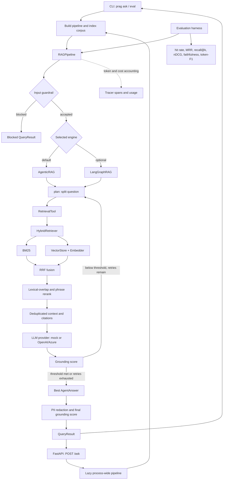

# Reverse Engineering Report

This report describes the repository's RAG system and traces its core request path through the eight primary implementation files. It is based on the bundled handbook corpus. The current default uses local FastEmbed embeddings and the mock LLM; set `RAG_EMBED_PROVIDER=hashing` for the deterministic offline embedding baseline.

## 1. Problem the project solves

This is a provider-swappable retrieval-augmented generation (RAG) reference system. It demonstrates engineering concerns beyond “embed a query, fetch top-k, call an LLM”:

- Load and chunk a corpus.
- Retrieve with both lexical and vector search.
- Decompose multi-part questions into retrieval steps.
- Generate an answer from retrieved context.
- Score answer/context token overlap and retry when that score is low.
- Apply input filtering and output PII redaction.
- Report citations, basic token/cost accounting, and evaluation metrics.

The default uses a deterministic mock LLM and local FastEmbed embeddings. FastEmbed runs locally after its model has been downloaded; the hashing provider remains available as an offline, deterministic baseline. OpenAI/Azure adapters and FastAPI are optional. This is an educational, in-memory reference implementation, not a production-ready hosted system. The index is local and ephemeral; the planner and reranker are heuristic; the evaluation set is illustrative; and the API lacks streaming and multi-tenant authentication.

## 2. Architecture



Both CLI and FastAPI converge on `RAGPipeline`. The built-in `AgenticRAG` is the default engine. Optional `LangGraphRAG` implements a similar plan/retrieve/generate/reformulate loop; the pipeline falls back to the built-in agent if graph construction fails.

## 3. End-to-end flow and major components

### CLI path

For `prag ask "..."`, `cli.main()` parses the command, `cmd_ask()` calls `_build()`, and `_build()` creates `RAGPipeline(Settings.from_env())`. It loads Markdown/text documents, chunks and indexes them, then `RAGPipeline.query()` checks input guardrails and calls the selected engine. The pipeline reconstructs contexts from citations, redacts PII, calculates final grounding, and returns `QueryResult`. The CLI prints JSON with the answer, citations, faithfulness, iteration count, and trace summary.

The `eval` command follows the same setup/indexing path, then loads labeled JSONL records and calls the pipeline for each case through `run_eval()`.

### FastAPI path

`api.main:ask()` validates an `AskRequest`, calls `get_pipeline()`, and invokes the same `RAGPipeline.query()`. `get_pipeline()` lazily creates a process-wide pipeline and indexes the bundled corpus on first use. `/health` returns a fixed `{"status":"ok"}`; it does not verify that the corpus or model provider is ready.

### Component roles

| Component | Role |
|---|---|
| `config.py` | Reads provider, retrieval, engine, and loop settings from environment variables. |
| `ingestion/loaders.py` | Loads Markdown and text files. |
| `ingestion/chunking.py` | Creates fixed-size overlapping or Markdown-section chunks with IDs and metadata. |
| `providers/embeddings.py` | Defines embedder interface, offline hashing embedder, OpenAI embedder, and factory. |
| `providers/llm.py` | Defines LLM interface, offline extractive mock, OpenAI/Azure adapter, and factory. |
| `retrieval/bm25.py` | Implements lexical BM25 retrieval. |
| `retrieval/vectorstore.py` | Keeps in-memory vectors, chunk records, an embedding cache, and cosine search. |
| `retrieval/hybrid.py` | Combines lexical and vector rankings using RRF and heuristic reranking. |
| `agents/planner.py` | Splits a question into subquestions with regular-expression heuristics. |
| `agents/tools.py` | Exposes retrieval as a callable `RetrievalTool`. |
| `agents/rag_agent.py` | Implements built-in planning, retrieval, generation, grounding, and retry loop. |
| `graph.py` | Optional LangGraph version of the agent flow. |
| `guardrails.py` | Blocks selected input patterns, redacts selected PII, and scores token grounding. |
| `observability.py` | Tracks nested spans, token counts, and estimated cost. |
| `evaluation/` | Loads labeled cases and computes retrieval and answer metrics. |
| `pipeline.py` | Wires dependencies, indexes documents, runs guardrails and engine, returns `QueryResult`. |
| `cli.py`, `api/main.py` | User-facing entry points to the shared pipeline. |

## 4. Eight core files: functions, inputs/outputs, and call relationships

### 4.1 `src/production_agentic_rag/pipeline.py`

**`QueryResult`** is the result object returned to interfaces. Its fields include question, answer, citation IDs, scored contexts, faithfulness, iteration count, blocked flag, and trace summary. Its `context_texts` property projects its contexts to strings.

**`RAGPipeline.__init__(settings)`** wires an embedder-backed `HybridRetriever`, LLM, `RetrievalTool`, `AgenticRAG`, and selected engine. Input is optional `Settings`; output is an initialized pipeline with empty indexes. It calls `build_embedder()`, `build_llm()`, and `_select_engine()`.

**`_select_engine()`** returns the built-in agent by default. If LangGraph is selected, it tries to construct `LangGraphRAG` and falls back to the built-in agent if construction raises. Output is an object with `.run(question, tracer)`.

**`add_document(text, doc_id, strategy)`** chooses a chunker, chunks one document, indexes its chunks, and returns the number indexed. It calls the selected chunker and `HybridRetriever.index()`.

**`add_documents(docs, strategy)`** applies `add_document()` across `Document` objects and returns the total chunk count.

**`query(question)`** checks the input, calls the engine, rebuilds contexts from citations, redacts PII, calculates final faithfulness, and returns `QueryResult`. Blocked input returns early with `blocked=True`.

```python
agent_answer = self._engine.run(question, tracer=tracer)
chunks_by_id = {r.chunk.id: r for h in agent_answer.hops for r in h.contexts}
contexts = [chunks_by_id[c] for c in agent_answer.citations if c in chunks_by_id]
answer, _ = redact_pii(agent_answer.answer)
faith = grounding_score(answer, [c.chunk.text for c in contexts])
```

The imported `GuardrailReport` is not used in this path.

### 4.2 `src/production_agentic_rag/agents/rag_agent.py`

**`Hop`** stores a subquestion and the `Scored` chunks retrieved for it. **`AgentAnswer`** stores the selected answer, hops, faithfulness, iteration number, and citation IDs.

**`_build_prompt(question, contexts)`** joins the context strings with `\n---\n` and formats the Context/Question/Answer prompt. It is called by `AgenticRAG.run()` and returns a prompt string.

**`AgenticRAG.run(question, tracer)`** runs the built-in plan/retrieve/generate/score/retry loop. It returns the best `AgentAnswer`. It calls `plan()`, the retrieval tool, `_build_prompt()`, `llm.complete()`, `grounding_score()`, and possibly `_reformulate()`.

```python
result = self.llm.complete(_SYSTEM, _build_prompt(question, contexts))
faith = grounding_score(result.text, contexts)
if faith >= self.faithfulness_threshold:
    break
query = self._reformulate(question, contexts)
```

The loop keeps the candidate with the highest faithfulness. If none meets the threshold, it still returns the best candidate seen. A key detail: reformulation changes the next retrieval query; synthesis continues to receive the original question.

**`_reformulate(question, contexts)`** appends up to 240 characters of retrieved text to the original question and returns the expanded search query.

### 4.3 `src/production_agentic_rag/agents/planner.py`

**`plan(question)`** splits on question marks, “and also”, “and”, semicolons, and “then”, trims punctuation, and drops short fragments. It returns a list of subquestions, or the stripped original if no usable fragment remains. Called by `AgenticRAG.run()`; it does not call another module.

```python
parts = re.split(r"\?\s*|\band also\b|\band\b|;|\bthen\b", question, flags=re.I)
subs = [p.strip(" ?.") for p in parts if len(p.strip(" ?.")) > 3]
return subs or [question.strip()]
```

This is a heuristic, and may split on “and” where no meaningful question boundary exists.

### 4.4 `src/production_agentic_rag/agents/tools.py`

**`RetrievalTool`** stores the retriever and parameters `k`, `candidate_k`, and `rerank`. It exists to give the agent a small callable interface instead of coupling it to retrieval internals.

**`RetrievalTool.__call__(query)`** takes one subquestion and returns `list[Scored]` by forwarding it to `HybridRetriever.retrieve()` with its configuration. It is called by `AgenticRAG.run()`.

### 4.5 `src/production_agentic_rag/retrieval/hybrid.py`

**`Scored`** pairs a `Chunk` and numeric score.

**`HybridRetriever.__init__(embedder, rrf_k)`** creates a `BM25`, `VectorStore`, RRF constant (default 60), and chunk-ID lookup.

**`index(chunks)`** indexes every chunk in BM25 and vector stores and in `_chunks`; called by pipeline ingestion.

**`retrieve(query, k, candidate_k, rerank)`** calls BM25 and vector candidate search, fuses their ranked IDs, builds `Scored` results, optionally reranks, and returns the first `k`. Input includes query plus limits/flag; output is `list[Scored]`.

**`_rrf(rankings)`** adds `1 / (rrf_k + rank + 1)` for each document’s rank in each list. It fuses rankings without requiring BM25 and cosine raw scores to share a scale.

**`_rerank(query, results)`** adds `0.2` per overlapping token and `0.5` if the full lowercase query occurs in the chunk, then sorts in place by the modified score.

### 4.6 `src/production_agentic_rag/retrieval/bm25.py`

**`BM25.__init__(k1, b)`** creates empty token, ID, document-frequency, and average-length structures. Defaults are `k1=1.5`, `b=0.75`.

**`index(doc_id, text)`** tokenizes text, stores tokens and ID, updates document frequencies, and recalculates average document length. Called by `HybridRetriever.index()`.

**`_idf(term)`** calculates smoothed inverse document frequency for a term; called by `search()`.

**`search(query, k)`** tokenizes the query, scores each indexed document using term frequency, IDF, and document-length normalization, and returns the top positive `(chunk_id, score)` pairs. Called by `HybridRetriever.retrieve()`.

### 4.7 `src/production_agentic_rag/retrieval/vectorstore.py`

**`VectorStore.__init__(embedder, cache_size)`** initializes an embedder, in-memory vector/chunk dictionaries, LRU cache, and hit/miss counters.

**`_embed_cached(text)`** hashes text for a cache key, returns a cached vector or embeds and inserts it, evicting the oldest item over capacity. Called by `add()`.

**`add(chunk)`** stores a chunk’s embedding and chunk object. Called during `HybridRetriever.index()`.

**`search(query, k)`** embeds the query, computes cosine similarity against stored vectors, sorts, and returns top positive `(chunk_id, score)` pairs. Called by `HybridRetriever.retrieve()`.

**`chunk(cid)`** returns a stored chunk but is not used in the main path; `HybridRetriever` maintains its own lookup.

`HashingEmbedder` produces sparse token-derived vectors. It is deterministic and useful for local tests, but it is not a semantic embedding model. The current default is `FastEmbedEmbedder` with `BAAI/bge-small-en-v1.5`.

### 4.8 `src/production_agentic_rag/providers/llm.py`

**`LLMResult`** packages text and usage. **`LLMProvider`** is a protocol requiring `complete(system, user) -> LLMResult`; it lets the agent use different providers through one interface.

**`MockLLM.complete(system, user)`** extracts context and question from the prompt, scores context sentences by token overlap, returns up to two matching sentences, and estimates token counts by whitespace splitting. It is called by the agent through `self.llm.complete()`. The mock does not use the system prompt argument.

**`OpenAILLM.complete(system, user)`** lazily imports the SDK, chooses Azure when `AZURE_OPENAI_ENDPOINT` is set and otherwise standard OpenAI, makes a temperature-zero completion, and returns text and usage.

**`build_llm(provider, model)`** returns `OpenAILLM` for `openai` or `azure`, and `MockLLM` otherwise. Called by `RAGPipeline.__init__()`.

## 5. Retrieval details

1. **BM25 candidates:** tokenized/stemmed term matches scored using term frequency, IDF, and length normalization.
2. **Vector candidates:** query embedding compared to stored chunk embeddings using cosine similarity. The default `FastEmbedEmbedder` produces local semantic vectors; `HashingEmbedder` remains the sparse deterministic baseline, and OpenAI embeddings remain an optional provider.
3. **RRF fusion:** each ranking contributes `1 / (rrf_k + rank + 1)` per chunk. Default `rrf_k=60`.
4. **Heuristic reranking:** adds shared-token overlap and exact-query phrase bonus.
5. **Top-k:** final `k` candidates are returned to the tool.

`VectorStore`’s LRU is keyed by a truncated SHA-256 of chunk text. It caches document/chunk embeddings but does not cache query embeddings.

## 6. Complete request trace

Request:

> “What is the return window and how long do refunds take?”

This trace uses `RAG_EMBED_PROVIDER=hashing` with `data/corpus/handbook.md`, indexed into Markdown section chunks. `handbook:0` is Returns Policy and `handbook:3` is Refunds. The values below were observed with the hashing baseline; the current default provider is FastEmbed.

| Order | Function and important values | Input → output |
|---|---|---|
| 1 | `RAGPipeline.query(question)` | Receives the exact question, creates `Tracer`, and calls `check_input()`. |
| 2 | `check_input(question)` | Accepts and trims the question. |
| 3 | `RAGPipeline.query()` → `self._engine.run(question, tracer)` | Default `_engine` is `AgenticRAG`. |
| 4 | `AgenticRAG.run()` setup | `query = question`; `best = None`; loop is iterations 1 through default `max_iterations=2`. |
| 5 | `plan(query)` | Returns `['What is the return window', 'how long do refunds take']`. |
| 6 | `RetrievalTool.__call__()` for subquestion 1 | Calls `HybridRetriever.retrieve('What is the return window', k=4, candidate_k=12, rerank=True)`. |
| 7 | `HybridRetriever.retrieve()` for subquestion 1 | Calls BM25 and vector searches, RRF, and reranking. Observed results: `handbook:0` score `0.2328`; `handbook:3` score `0.2323`. |
| 8 | `RetrievalTool.__call__()` for subquestion 2 | Calls `HybridRetriever.retrieve('how long do refunds take', ...)`. Observed results: `handbook:3` score `0.2328`; `handbook:0` score `0.2323`. |
| 9 | `AgenticRAG.run()` records retrieval | `hops` has one `Hop` per subquestion. `seen` is keyed by chunk ID and uses `setdefault`, so deduplicated first-seen order is `handbook:0`, `handbook:3`. |
| 10 | `contexts = [r.chunk.text for r in seen.values()]` | Two full section texts: Returns Policy and Refunds. |
| 11 | `_build_prompt(question, contexts)` | Joins those texts using `\n---\n`, then adds the original combined question. |
| 12 | `MockLLM.complete(_SYSTEM, prompt)` | Parses context/question, selects matching sentences, returns `LLMResult`. Observed answer: “Customers may return any unused item within 30 days of delivery for a full refund, provided it is in original packaging. --- Approved refunds are issued to the original payment method within 5 business days of the returned item being received and inspected.” |
| 13 | `grounding_score(result.text, contexts)` in agent | Measures the fraction of answer tokens also present in context. Observed value: `1.0`. |
| 14 | Retry decision | `1.0 >= faithfulness_threshold` (default `0.6`), so it breaks at iteration 1. `_reformulate()` is not called. |
| 15 | `AgenticRAG.run()` returns `AgentAnswer` | `citations = list(seen.keys())`, hence `['handbook:0', 'handbook:3']`; answer, hops, faithfulness, and `iterations=1` are included. |
| 16 | `RAGPipeline.query()` reconstructs contexts | Builds `chunks_by_id` from returned hops, then chooses chunks in citation order. |
| 17 | `redact_pii()` and pipeline `grounding_score()` | No PII is present. Grounding is recalculated after redaction; observed value remains `1.0`. |
| 18 | `QueryResult` returned | Citations and contexts are `handbook:0` and `handbook:3`; `iterations=1`. Trace summary: 6 spans, 69 input tokens, 43 output tokens, `$0.0` estimated cost. |

The six spans are `pipeline.query`, `agent.run`, `plan`, two `retrieve` spans, and `synthesize`. The BM25, vector, RRF, and rerank functions do not create individual spans.

### Citation production

Citations are chunk IDs, not generated citations embedded in answer text. During each iteration, retrieved results are deduplicated into `seen`; the candidate uses `citations=list(seen.keys())`. The pipeline then resolves these IDs back to `Scored` chunks from the candidate’s hops.

### Retry path if grounding is low

If the agent score is below threshold, `_reformulate(original_question, contexts)` appends up to 240 characters of retrieved context to the original question. The next iteration calls `plan()` on that expanded retrieval query. The synthesis prompt still uses the original question. After the final iteration, the agent returns the candidate with the highest score, even if below threshold.

## 7. Evaluation

`evaluation/harness.py` reads JSONL cases containing question, optional reference answer, and relevant chunk IDs. It calls `pipeline.query()` per case and evaluates returned citations and answer.

- **Hit rate@k** (`hit_rate`): share of queries with at least one relevant ID in top-k.
- **MRR:** mean reciprocal rank of the first relevant citation.
- **Recall@k:** fraction of relevant IDs retrieved, averaged over cases with nonempty gold sets.
- **nDCG@k:** discounted binary relevance, normalized by ideal ranking.
- **Faithfulness:** fraction of answer tokens present in the combined context tokens.
- **Answer correctness:** token-set F1 against reference; set-based, so repetition does not add weight.

Retrieval metrics use `result.citations`, the selected answer’s citations, rather than a separately retained raw retrieval ranking. The bundled dataset contains five questions and one relevant ID per case; its scores are smoke signals, not evidence of general model quality.

## 8. Guardrails and observability

### Guardrails

`check_input()` rejects inputs over 2,000 characters and matches a small set of regex patterns for instruction overrides or secret extraction. Rejected inputs return a blocked `QueryResult` with no citations and zero iterations. After generation, `redact_pii()` replaces selected US-style SSNs, 16-digit strings, and email addresses. `grounding_score()` checks token overlap.

These are heuristics. Token overlap may score an answer highly even if it changes a number, negates a statement, or combines unrelated facts. It is not a semantic faithfulness judge. `GuardrailReport` is defined but not used in the primary query path.

### Observability

`Tracer.span()` records nested spans, parent IDs, and durations. The agent traces `agent.run`, `plan`, `retrieve`, and `synthesize`; the pipeline traces `pipeline.query`. `record_usage()` accumulates prompt/completion tokens and estimates cost from an illustrative price book. The returned summary includes span count, token totals, and cost; it does not include total latency or the span tree. The optional export integration is not automatically invoked by normal queries.

## 9. Interfaces

- `cli.py`: `_build()` creates a new pipeline and indexes the requested corpus per CLI command. `ask` calls `query()`; `eval` uses `run_eval()`.
- `api/main.py`: lazily creates and reuses one process-level pipeline for `/ask`; response omits contexts and trace. API response includes `blocked`; CLI ask JSON omits it.
- `Settings.from_env()`: provides provider, model, retrieval, engine, and threshold configuration to both interfaces.

## 10. Interview priorities

### Understand well

- How pipeline, provider, retrieval, agent, guardrail, and evaluation responsibilities are separated.
- How a query goes through two retrievers, RRF, reranking, and context assembly.
- How multi-part planning, deduplication, citations, and retry work.
- What offline defaults actually do and what changes with OpenAI providers.
- How faithfulness/evaluation are computed and what they cannot detect.
- How chunk IDs flow into citations.
- Which components are in-memory or heuristic and what would need replacement for scale or quality.

### Safe to skim initially

- Packaging and Docker wiring (`pyproject.toml`, `Makefile`, `Dockerfile`).
- Optional sibling-library integrations in `integrations.py`.
- LangGraph internals unless the role emphasizes graph orchestration.
- Most test implementation details; tests are useful for confirming intended behavior.

## 11. Interview function lists

### A. Ten functions to understand for an interview

1. `RAGPipeline.__init__`
2. `RAGPipeline.query`
3. `AgenticRAG.run`
4. `AgenticRAG._reformulate`
5. `plan`
6. `RetrievalTool.__call__`
7. `HybridRetriever.retrieve`
8. `HybridRetriever._rrf`
9. `BM25.search`
10. `MockLLM.complete`

For vector retrieval, add `VectorStore.search`; for indexing, add `HybridRetriever.index`.

### B. Ten functions/details safe to defer

These are lower priority for explaining the core request path, not permanently irrelevant:

1. `QueryResult.context_texts` — convenience projection from chunks to strings.
2. `RAGPipeline._select_engine` — optional engine choice and fallback detail.
3. `RAGPipeline.add_document` — ingestion entry point, separate from request execution.
4. `RAGPipeline.add_documents` — wrapper over multiple documents.
5. `HybridRetriever.size` — index-size property.
6. `VectorStore.__init__` — cache/store initialization details.
7. `VectorStore._embed_cached` — LRU cache mechanics.
8. `VectorStore.add` — storage operation; know indexing embeds chunks, but defer internals.
9. `VectorStore.chunk` — lookup helper not used in this main path.
10. `OpenAILLM.__init__` — stores model name only.

### C. Ten technical interview questions

1. Why combine BM25 and vector search rather than rely on one retriever?
2. Why use Reciprocal Rank Fusion instead of adding BM25 and cosine scores directly?
3. What do BM25 IDF and document-length normalization contribute?
4. How does the default FastEmbed provider differ from the hashing baseline?
5. How does the planner split this query, and what can go wrong with the regex approach?
6. How does `seen` deduplicate results across subquestions, and how does that determine citations?
7. What does the grounding score measure, and what errors can it miss?
8. What changes during self-correction, and does generation use the expanded query?
9. How would you replace heuristic reranking with a cross-encoder while preserving interfaces?
10. What would need to change for persistent indexing or concurrent multi-tenant requests?

## 12. Limitations and implementation caveats

- **In-memory index:** data is not persisted; the vector store is process-local.
- **Hashing vectors are token-derived:** hashing is deterministic but not semantically rich; the default FastEmbed model requires a first-use model download.
- **Heuristic planning/reranking:** rule-based decomposition and lexical overlap can be brittle.
- **Grounding is lexical:** token inclusion does not establish entailment or factual correctness.
- **Evaluation set is tiny:** five examples do not establish production performance.
- **Heuristic answer correctness:** token-set F1 ignores synonymy, word order, and repeated terms.
- **No streaming or tenant isolation:** API returns whole responses and is single-tenant.
- **Trace summary is limited:** spans contain timings, but the normal result summary omits total latency/span tree.
- **Configured chunk-size settings:** `RAG_CHUNK_SIZE` and `RAG_CHUNK_OVERLAP` exist in settings, while the pipeline’s default section chunker does not use them.

## 13. Minimum source set for explaining about 80% of the system

Start with these eight files:

1. `src/production_agentic_rag/pipeline.py`
2. `src/production_agentic_rag/agents/rag_agent.py`
3. `src/production_agentic_rag/agents/planner.py`
4. `src/production_agentic_rag/agents/tools.py`
5. `src/production_agentic_rag/retrieval/hybrid.py`
6. `src/production_agentic_rag/retrieval/bm25.py`
7. `src/production_agentic_rag/retrieval/vectorstore.py`
8. `src/production_agentic_rag/providers/llm.py`

Then add `ingestion/chunking.py`, `providers/embeddings.py`, `evaluation/metrics.py`, and `guardrails.py` to explain ingestion, embedding behavior, metrics, and safety checks in more depth.
